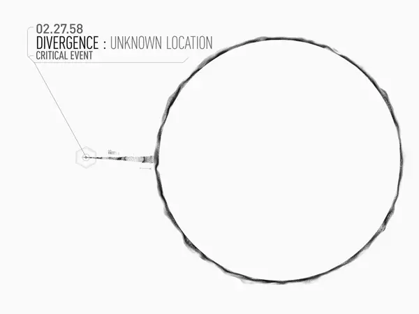

# Rehoboam
The rehoboam West World Quantum AI interface

A tribute to the TV series West World's Rehoboam divergence interface

In the West World Tv series, Rehoboam is an artificially intelligent quantum computer whos main function is to impose an order to human affairs by careful manipulation and prediction of the future made possible by analysis of the large data set Incite have collected.

Rehoboam is able to analyse the files of millions of human subjects. With that data the system is able to predict the course and the outcome of individual lives.
                    
It also compares its analysis with the real world to spot divergences.  

                          
                            
I use perlin noise to generate the datapoints and pull a news feed to populate the call outs.
